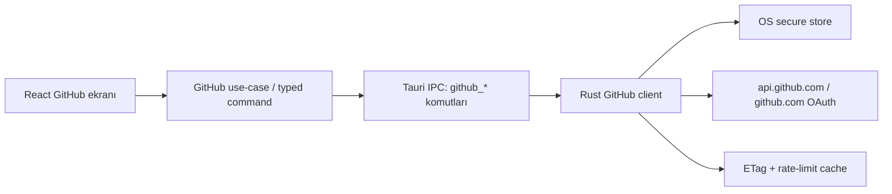
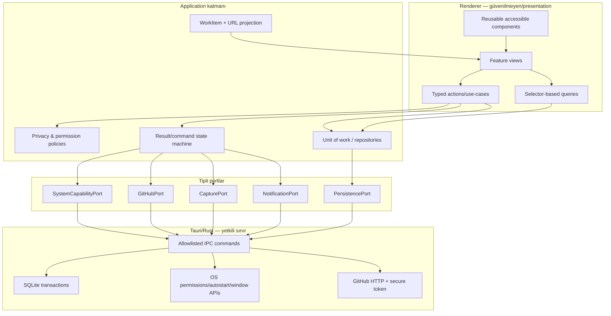

# Qutra Labs / Qutra Labs — Frontend, kullanılabilirlik, güven ve mimari derin denetimi

**Denetim tarihi:** 29 Temmuz 2026  
**İncelenen kaynak:** `64c421c1cce265f5c8abb820462be844fab7c7f3` tabanındaki güncel, commitlenmemiş çalışma ağacı  
**Dal:** `phase-3-personal-lab`  
**Kapsam:** React/TypeScript arayüz, kullanıcı akışları, klavye ve ekran okuyucu davranışı, responsive/zoom, tema ve kontrast, i18n, Tauri/WebView2 sınırı, GitHub ve yerel platform entegrasyonları, veri kalıcılığı, import/export, otomasyonlar, test ve release güveni  
**Yaklaşım:** negatif ve risk odaklı; her bulgu için çalışma zamanı veya kod kanıtı, kullanıcı etkisi, kök neden, çözüm mimarisi ve kabul testi

> Bu rapor bir “kod güzel mi?” incelemesi değildir. Kullanıcıya verilen söz ile uygulamanın gerçekten yaptığı şey arasındaki farkı, veri kaybı ve gizlilik riskini, erişilebilirliği ve sürüm güvenini inceler.

---

## 1. Yönetici kararı

### Sonuç

Uygulama iyi bir prototip/erken ürün tabanına sahip olsa da mevcut çalışma ağacı **üretim sürümü için hazır değildir**. En ağır sorunlar görsel ciladan çok güven doğruluğundadır:

1. Etkinlik kaydı kapalıyken olaylar yine kaydediliyor ve otomasyonlar tetikleniyor.
2. GitHub’ın gerçek ağ yolu CSP tarafından engelleniyor; ayrıca “Device Flow” düğmesi Device Flow’u başlatmıyor.
3. İzin, başlangıçta çalıştırma ve bildirim ayarlarının bir bölümü gerçek işletim sistemi durumunu değiştirmeden başarı veya açık durum gösteriyor.
4. SQLite yazımı tamamlanmadan UI başarı kabul ediyor; hata yalnız konsola yazılıyor ve çağırana dönmüyor.
5. “Tüm veriyi dışa aktar” dosyası, import edildiğinde tercihleri geri yüklemiyor ve hedefi bire bir geri getirmiyor.
6. 900 piksel altındaki sidebar responsive kuralı inline `width` nedeniyle çalışmıyor; zoom/reflow kullanımını bozuyor.
7. Ana sekme çubuğu WAI-ARIA sekme sözleşmesini ihlal ediyor; dialog kapanınca odak kayboluyor; WCAG AA kontrastı hem açık hem koyu temada geçmiyor.

### Yayın kararı

**Karar: No-go.** Aşağıdaki R0 maddeleri kapanmadan “güvenilir yerel-first masaüstü uygulaması” olarak dağıtılmamalı:

- R0-01 Etkinlik/gizlilik anahtarı
- R0-02 GitHub gerçek bağlantı yolu
- R0-03 İzin ve sistem ayarlarının gerçeklik modeli
- R0-04 Kalıcı yazım başarısının doğrulanması
- R0-05 Tam yedek/geri yükleme sözleşmesi

### Kanıta dayalı olgunluk göstergesi

Bu puan mutlak ürün puanı değil, önceliklendirme göstergesidir:

| Alan | Puan / 10 | Kısa gerekçe |
|---|---:|---|
| Temel görsel tutarlılık | 6,0 | Genel kabuk düzenli; fakat responsive, eksik CSS sınıfları ve kontrast sorunlu |
| Kullanılabilirlik / görev tamamlama | 4,5 | Temel route’lar çalışıyor; bazı ayarlar ve entegrasyonlar yanıltıcı veya etkisiz |
| Erişilebilirlik | 3,0 | Kritik ARIA, focus return, skip-link, heading ve kontrast ihlalleri |
| Frontend mimarisi | 4,5 | Route lazy-loading iyi; büyük bileşenler, geniş subscription ve route=tab kimliği borçlu |
| Veri bütünlüğü / kalıcılık | 3,0 | Optimistic yazım hataları yutuluyor; import tam restore değil |
| Gizlilik / güvenlik | 3,5 | CSP sıkı fakat ürün davranışıyla çelişkili; privacy anahtarı uygulanmıyor |
| Test / release güveni | 4,0 | 323 unit test var; E2E paralellik ve görsel test sözleşmesi yanlış güven üretiyor |
| **Ağırlıksız gösterge** | **4,1** | Sağlam prototip; production-grade güvenilirlik değil |

Bir gün önceki iç araştırma 5,2/10 vermişti. Bu denetimde çalışan UI üzerinden doğrulanan gizlilik, GitHub, izin, kalıcılık ve restore bulguları puanı aşağı çekiyor. Bu fark, statik mimari incelemenin gerçek kullanıcı akışları ve ağ/veri hatası enjeksiyonu ile tamamlanması gerektiğini gösteriyor.

---

## 2. Denetim yöntemi ve sınırlar

### Uygulanan kontroller

| Kontrol | Sonuç | Yorum |
|---|---:|---|
| `npm.cmd run typecheck` | Başarılı | TypeScript derleme sözleşmesi geçiyor |
| `npm.cmd test -- --reporter=verbose` | **323/323**, 40 dosya | Unit/component test tabanı güçlü görünüyor |
| `npm.cmd run build` | Başarılı | Ana JS 774,35 kB raw / 235,26 kB gzip |
| `npm.cmd run test:e2e` | **49 geçti, 3 kaldı, 7 çalışmadı** | 8 worker ile timeout/yüklenme yarışları |
| `visual.spec.ts --workers=1` | 5/5 | Tek worker’da geçti |
| `scroll.spec.ts --workers=1` | 15/15 | Tek worker’da geçti |
| `app.spec.ts --workers=1` | 8/8 | Tek worker’da geçti |
| `npm.cmd audit --json` | 2 high | React Router RSC advisory; bu SPA’da mevcut exploit yolu yok |
| Axe Core, 9 route, light; seçili dark | İhlaller bulundu | Tablist yapısı kritik; kontrast serious |
| Klavye/focus manuel testi | Sorun bulundu | 51 tab stop; dialog kapanınca focus `BODY` |
| 1440, 800, 480 ve 320 CSS px davranışı | Sorun bulundu | Sidebar inline width; dar alanda yatay taşma |
| Gizlilik anahtarı manuel veri testi | Sorun doğrulandı | Kapalıyken `workspace_opened` event yazıldı |
| GitHub gerçek fetch denemesi | Engellendi | CSP `connect-src` isteği blokladı |
| `cargo test` | Ortam/yol blokajı | `28''` yolundaki apostrof `RC.EXE` komutunu bozuyor |

### Çalışma ağacı uyarısı

Denetim başında çalışma ağacı zaten çok kirliydi; son ölçümde `git status` 337 kayıt ve 193 değiştirilmiş takipli dosya gösterdi. Bu nedenle:

- Bulgular **HEAD commitine değil, o anda diskte bulunan çalışma ağacına** aittir.
- Mevcut hâl commit/tag ile sabitlenmeden sonuçlar başka makinede bire bir üretilemez.
- E2E görsel süiti mevcut `e2e/screenshots` çıktılarını yeniden üretti.
- Mevcut paketler 24–25 Temmuz tarihli; 29 Temmuz kaynak ağacını temsil etmiyor.

### İncelenemeyen veya sınırlı alan

- Güncel native uygulama, klasör yolundaki iki apostrof nedeniyle bu konumda yeniden derlenemedi.
- Eski paketleri “güncel uygulama” diye kullanmak yanlış olacağı için paketli smoke ana kanıt yapılmadı.
- Narrator ile gerçek insan ekran okuyucu oturumu yapılmadı; DOM/ARIA, axe ve klavye testi yapıldı.
- Uzun süreli gerçek veri seti, düşük güçlü referans cihaz ve disk-hata enjeksiyon testi yapılmadı. Kod yolu yine de kalıcılık hatasını kesin olarak gösteriyor.

---

## 3. Öncelik tanımı

| Düzey | Anlam |
|---|---|
| **R0 — Yayın engeli** | Gizlilik, veri kaybı, temel entegrasyonun çalışmaması veya kullanıcıya yanlış başarı gösterme |
| **R1 — Release öncesi** | Ana görevi, erişilebilirliği, zoom/klavye kullanımını veya test güvenini ciddi bozar |
| **R2 — Yakın dönem** | Verimlilik, bakım, performans, tutarlılık ve profesyonel kaliteyi düşürür |
| **R3 — İyileştirme** | Doğrudan engel değil; büyüdükçe maliyet ve hata olasılığı yaratır |

---

## 4. R0 — Yayın engeli bulguları

### R0-01 — “Etkinlik kaydı kapalı” olmasına rağmen olay kaydediliyor

**Kanıt**

- `src/services/appService.ts:27-46` içindeki `recordEvent()` doğrudan `events.put()` ve `fireAutomations()` çağırıyor.
- Bu fonksiyonda `prefs.activityTrackingEnabled` kontrolü yok.
- `src/domain/types.ts:455` varsayılanı `false` olarak tanımlıyor; yani ilk açılışta bile kayıt kapalı görünmeli.
- Manuel doğrulama: `activityTrackingEnabled:false` iken UI’dan “Gizlilik Testi” çalışma alanı oluşturuldu; `contextos.v1.events` içine `workspace_opened` yazıldı.
- Privacy ekranı aynı anda yakalamanın duraklatıldığını söylüyor.

**Kullanıcı etkisi**

- Kullanıcının açık gizlilik seçimi ihlal ediliyor.
- Sadece log yazılmıyor; `fireAutomations()` da çalıştığı için kapalı izleme dolaylı eylem üretebilir.
- “Yerel-first” olmak, onamı görmezden gelmeyi meşru kılmaz; verinin cihazdan çıkmaması ayrı, kullanıcının kayıt istememesi ayrıdır.

**Kök neden**

Preference, arayüz durumu olarak modellenmiş; domain politikasına dönüştürülmemiş. Olay üretimi merkezi olsa da privacy guard merkezi değil.

**Çözüm mimarisi**

1. `recordEvent` doğrudan global DB kullanan senkron yardımcı olmaktan çıkarılmalı.
2. Bir `ActivityPolicy` veya `EventRecorder` portu oluşturulmalı:

   ```ts
   type RecordOutcome =
     | { status: "recorded"; eventId: string }
     | { status: "skipped"; reason: "tracking_disabled" };

   interface EventRecorder {
     record(input: ActivityInput): Promise<RecordOutcome>;
   }
   ```

3. Policy, güncel preference snapshotını tek noktada kontrol etmeli.
4. `tracking_disabled` iken hem event yazımı hem otomasyon tetiklemesi sıfır olmalı.
5. İzin değişikliği gibi zorunlu güvenlik audit kayıtları tutulacaksa bunlar kullanıcı etkinlik logundan ayrı, açıkça belgelenmiş ve ayrı retention politikasına sahip olmalı.

**Kabul testleri**

- Tracking `false`: çalışma alanı oluştur, oturum başlat, snapshot al; event sayısı ve automation run sayısı değişmemeli.
- Tracking `true`: aynı akışta doğru eventler bir kez yazılmalı.
- Uygulama açıkken anahtar değiştirildiğinde stale closure kullanılmamalı.
- Import ile preference değiştiğinde politika yeniden okunmalı.

---

### R0-02 — GitHub entegrasyonu gerçek ortamda çalışmıyor; Device Flow da yanlış bağlanmış

**Kanıt A: CSP**

- `src/features/github/provider.ts:17`, `:104-119` REST çağrılarını `https://api.github.com` adresine renderer `fetch()` ile gönderiyor.
- `src/features/github/provider.ts:178-188` GraphQL çağrısını aynı hosta gönderiyor.
- `src/features/github/deviceFlow.ts:30-31` `https://github.com/login/...` adreslerini kullanıyor.
- `index.html:8` ve `src-tauri/tauri.conf.json:25` `connect-src` içinde yalnız `'self'`, `ipc:` ve `http://ipc.localhost` izinli.
- Gerçek `fetch("https://api.github.com/user")` denemesi `TypeError` ve CSP violation üretti.

**Kanıt B: Device Flow düğmesi**

- `src/features/github/GitHubPage.tsx:183-187` “Device Flow” düğmesinin `onClick` değeri `loadLive`.
- `loadLive` yalnız mevcut token ile profil/repo çağrılarını yapıyor.
- `deviceFlow.ts` ve testleri mevcut, fakat sayfa tarafından çağrılmıyor.
- Sonuç: client id konfigüre edilirse görünen birincil bağlantı düğmesi OAuth akışını başlatmıyor.

**Kanıt C: token sınırı**

- `src/features/github/provider.ts:68-69`, tokenı secure store’dan renderer JavaScript belleğine alıyor.
- `:109-118`, tokenı `Authorization` header içine koyarak renderer’dan fetch ediyor.
- Dosya yorumu “token dönmez” dese de token fiilen renderer süreç/bellek sınırına geçiyor.

**Kullanıcı etkisi**

- PAT doğru biçimde kaydedilebilir fakat hemen ardından gerçek yükleme “offline” olarak düşer.
- Kullanıcı ağ sorunu veya hatalı token zannedebilir; asıl sebep ürünün kendi CSP’sidir.
- Device Flow görünür olduğunda düğme etkisizdir.
- Unit testler mock `fetch` kullandığı, E2E demo verisi kullandığı için temel entegrasyon kırığı yakalanmıyor.

**Tercih edilen çözüm**

GitHub erişimini Rust/native uygulama servisine taşı:



- Renderer tokenı hiçbir zaman almamalı.
- Rust komutları `connect_device_flow`, `connect_pat`, `get_profile`, `list_repos`, `get_contributions`, `disconnect` gibi tipli olmalı.
- Capability manifest yalnız bu komutları ilgili window için açmalı.
- CSP sıkı kalmalı; GitHub hostlarını renderer `connect-src` içine açmaya gerek kalmamalı.
- Device Flow için ilerleme bir event/channel ile `requesting_code → waiting_user → polling → connected/expired` olarak aktarılmalı.

**Geçici ikinci seçenek**

Renderer fetch korunacaksa `connect-src` içine yalnız kesin gereken originler eklenebilir. Bu daha zayıf seçenektir; token renderer’a geçtiği için XSS etkisi büyür. Tauri’nin kendi rehberi CSP’yi mümkün olduğunca dar tutmayı önerir.

**Kabul testleri**

- Paketli Tauri’de gerçek test hesabıyla Device Flow uçtan uca.
- PAT yanlış biçim, geçersiz token, 401, 403, rate limit, offline, timeout.
- Token DOM, log, diagnostic, error message veya frontend state dump içinde bulunmamalı.
- CSP violation sıfır; renderer’ın doğrudan GitHub fetch yapmadığı test edilmeli.
- OAuth cancel/expiry doğru durum göstermeli; düğme tekrar denenebilir olmalı.

---

### R0-03 — İzinler ve sistem ayarları gerçek durum yerine uygulama içi kayıt gösteriyor

**Kanıt**

- `src/features/settings/SettingsPage.tsx:161-165`: grant/revoke yalnız `permissions` koleksiyonuna bir satır yazıyor.
- `:611-619`: “Erişimi test et” Tauri’de herhangi bir test yapmadan `perm.testOk` toastı gösteriyor.
- `:623-633`: “Sistem ayarlarını aç” Tauri’de bile yalnız `perm.simulated` toastı gösteriyor.
- `src/features/onboarding/OnboardingPage.tsx:64-65`: onboarding izni de yalnız DB kaydı.
- Tauri notification bridge’i gerçekte `isPermissionGranted()` / `requestPermission()` kullanabiliyor (`src/lib/bridge/tauriBridge.ts:353-363`), fakat Settings bu adaptera bağlı değil.
- Tauri capability izni, Windows/macOS işletim sistemi izniyle aynı şey değildir.

**Kullanıcı etkisi**

- Ekran “verildi” veya “test başarılı” diyebilir, fakat işletim sistemi izni verilmemiş olabilir.
- Tersine, OS izni vardır ama uygulama içi kayıt “reddedildi” kalabilir.
- Güvenlik ve gizlilik ekranı güvenilir bir gerçeklik kaynağı olmaktan çıkar.

**Çözüm mimarisi**

Her izin için üç ayrı eksen tutulmalı:

```ts
type CapabilityView = {
  support: "supported" | "unsupported";
  effective: "granted" | "denied" | "prompt" | "unknown";
  intent: "enabled" | "disabled";
  lastCheckedAt?: number;
  reason?: string;
};
```

- `intent`: kullanıcının Qutra içindeki tercihi.
- `effective`: işletim sisteminden canlı okunan gerçek durum.
- `support`: platform/derleme yeteneği.
- UI yalnız gerçek adapter sonucu sonrası “başarılı” demeli.
- “Sistem ayarlarını aç” platforma özgü, gerçekten çalışan deep-link/command yoksa gizlenmeli veya “bu platformda desteklenmiyor” olarak disabled olmalı.
- Tauri capability manifesti yalnız IPC komut yetkisini belirlemeli; UI bunu OS izni diye sunmamalı.

**Kabul testleri**

- Native permission adapter success/denied/error.
- OS ayarından izin dışarıda değiştirildiğinde ekran yenilenince doğru duruma gelmeli.
- Browser modunda kontrol gösterilmemeli veya açıkça “demo/desteklenmiyor” denmeli.
- Test düğmesi gerçekten küçük, geri alınabilir capability probe yapmalı.

---

### R0-04 — Kalıcı yazım tamamlanmadan başarı gösteriliyor; yazım hatası çağırana ulaşmıyor

**Kanıt**

- `src/lib/db/sqliteAdapter.ts:71-79`: `write/remove` önce in-memory mirror’ı değiştiriyor, sonra async işi kuyruğa alıyor; dönüş tipi `void`.
- `:96-100`: persistence hatası `.catch()` içinde yalnız `console.error` ile yutuluyor.
- `flush()` `:91-94`, hata yutulduğu için başarısız yazımı reject edemiyor.
- Collection yazımı `:103-123`, bütün koleksiyonu silip her kaydı yeniden insert ediyor.
- UI katmanı `put/patch/set` çağrısından sonra işlemi başarı sayıyor.

**Kullanıcı etkisi**

- Disk dolu, dosya kilitli, I/O veya SQL hatasında ekranda veri görünür ve başarı toastı çıkabilir; yeniden başlatınca veri kaybolur.
- Mirror ile disk birbirinden ayrışır.
- Arka arkaya büyük koleksiyon yazımları O(n) full-replace iş yükü üretir; kuyruk gecikmesi büyür.

**Kök neden**

Senkron localStorage benzeri repository API’si, async SQLite durability üzerine aynen taşınmış. “UI state değişti” ile “kalıcı commit oldu” aynı sözleşme kabul edilmiş.

**Çözüm mimarisi**

- Domain mutation API’si async `Result` dönmeli:

  ```ts
  type PersistResult<T> =
    | { ok: true; value: T; committedAt: number }
    | { ok: false; error: PersistError; retryable: boolean };
  ```

- Kritik işlemlerde UI ancak transaction commit sonrası başarı göstermeli.
- Optimistic UI korunacaksa `saving / saved / failed / retrying` durumu görünür olmalı ve rollback/retry olmalı.
- Kuyruk ilk hatayı saklamalı; sonraki işlerin davranışı açık olmalı. `flush()` hata döndürebilmeli.
- Full collection replace yerine row-level `UPSERT`, `DELETE`, transaction/unit-of-work.
- Kayıt sırası önemliyse `position` alanı kullanılmalı; aynı `updated_at` değerine güvenilmemeli.
- Shutdown’da pending write sayısı ve son hata diagnosticte görünmeli.

**Kabul testleri**

- Enjekte edilmiş SQL failure: UI “kaydedildi” dememeli.
- Disk hata sonrası restart: mirror/disk ayrışması tespit edilmeli.
- Aynı kayda yarışan iki mutation deterministik olmalı.
- 10, 1.000 ve 10.000 kayıt benchmarkı; tek kayıt değişimi O(1)/O(log n) SQL yazımı olmalı.

SQLite transactionları commit öncesi değişiklikleri diğer bağlantılara göstermeyerek atomic/serializable davranış sağlar; uygulamanın da başarıyı transaction commitine bağlaması gerekir.

---

### R0-05 — “Tüm veriyi dışa aktar” dosyası tam geri yüklenmiyor

**Kanıt**

- `src/lib/db/database.ts:214-229`: export `schemaVersion`, `preferences` ve tüm koleksiyonları içeriyor.
- `:232-247`: import yalnız `app` ve `data` kontrol ediyor.
- `schemaVersion` uyumluluğunu kullanmıyor.
- `preferences` hiç import edilmiyor.
- `bulkPut` ile merge yapıyor; hedef DB’de exportta olmayan eski kayıtları silmiyor.
- Geçersiz satırları sessizce filtreliyor ve yine `ok:true` dönebiliyor.
- `src/lib/db/database.test.ts:263-279` “round trip” testinde yalnız workspace sayısı karşılaştırılıyor; preference ve bire bir veri eşitliği test edilmiyor.

**Kullanıcı etkisi**

- Kullanıcı bunu yedek/restore sanır; tema, gizlilik, çalışma sekmeleri ve diğer tercihler geri gelmez.
- Hedefteki eski kayıtlar kalır; restore sonrası beklenmeyen birleşik veri oluşur.
- Kısmi import başarılı gösterilebilir.
- Yeni/uyumsuz schema sessiz veri kaybı üretebilir.

**Çözüm**

1. “Birleştir” ve “Yedeği geri yükle” iki ayrı işlem olmalı.
2. Export için Zod ile sürümlü archive schema tanımlanmalı.
3. Önce bütün dosya parse/validate/migrate edilmeli; tek satır bile geçersizse kullanıcıya ayrıntılı özet sunulmalı.
4. Restore:
   - mevcut DB’nin otomatik güvenlik yedeğini al,
   - tek transaction içinde koleksiyonları ve preferences’ı değiştir,
   - commit sonrası sayım/hash doğrula,
   - hata olursa rollback.
5. Merge için ID çakışma politikası ve kullanıcı önizlemesi olmalı.
6. Ürün adı değişmiş olsa bile archive format kimliği geriye uyumluluk için açıkça versionlanmalı.

**Kabul testleri**

- Preferences dahil byte-equivalent semantic round-trip.
- Hedefte fazladan kayıt varken restore sonrası fazlalık kalmamalı.
- Merge seçeneğinde fazlalık kalmalı ve sonuç özeti doğru olmalı.
- Eski schema migration, gelecekteki schema reject, kısmi bozuk payload rollback.

---

## 5. R1 — Release öncesi ciddi bulgular

### R1-01 — Otomasyon sonucu çalışmadan “başarılı” yazılıyor

**Kanıt**

- `src/services/appService.ts:121-124`: notification Promise’ı `await` edilmiyor; hemen `notify ✓` yazılıyor.
- `:139-147`: URL açma Promise’ı da beklenmiyor.
- `:150-157`: `run_command`, `webhook`, `export_report`, `capture_snapshot`, `start_timer` çalıştırılmıyor; yalnız “requires desktop/confirmation” detayı ekleniyor.
- Buna rağmen `ok` `true` kaldığı için `:161-169` run status `success`.

**Etkisi**

Audit ve otomasyon geçmişi gerçeği yansıtmıyor. Kullanıcı yapılmamış eylemi yapılmış sanabilir.

**Çözüm**

- Executor tamamen async olmalı.
- Her action `succeeded | failed | skipped | blocked | awaiting_confirmation` dönmeli.
- Run aggregate status açık kuralla hesaplanmalı; `skipped` hiçbir zaman `success` sayılmamalı.
- Notification/open URL adapter sonucu ve permission hatası kaydedilmeli.

---

### R1-02 — Browser modunda sahte uygulamalar gerçek snapshot adayı gibi sunuluyor

**Kanıt**

- `src/lib/bridge/browserBridge.ts:154-188`: VS Code, Windows Terminal ve Firefox için gerçekçi sabit yollar/pencere başlıkları dönüyor.
- Bridge capability bu davranışı simulated olarak biliyor.
- Snapshot dialog bu adayları gerçek yakalanmış öğeler gibi gösteriyor.
- `src/services/appService.ts:419-455` Snapshot modeline `simulated` veya provenance eklemiyor.
- Restore run’da ise `:468` simulated alanı var; capture tarafı asimetrik.

**Etkisi**

Demo artefactı kaydedilebilir, export edilebilir ve gerçek cihaz snapshotı sanılabilir.

**Çözüm**

- Browser/dev modunda capture kapalı olmalı veya kalıcı “Demo verisi” bannerı bulunmalı.
- `Snapshot` ve `SnapshotItem` içine `source: "native" | "demo" | "imported"` eklenmeli.
- Demo snapshot, gerçek restore girdisi olarak kullanılmamalı.

---

### R1-03 — 900 px altı responsive sidebar kuralı inline style nedeniyle çalışmıyor

**Kanıt**

- `src/app/workbench/ContextSidebar.tsx:219`: açık sidebar’a inline `{ width: liveWidth }`.
- `src/app/workbench/workbench.css:775-799`: media query açık sidebar’ı `var(--sidebar-rail-w)` yapmak istiyor.
- Normal stylesheet kuralı inline style’ı yenemez.
- 800×900 ekran görüntüsünde label’lar kayboluyor fakat sidebar 240 px boş sütun olarak kalıyor.
- 480 CSS px’de ana alan yaklaşık 240 px; 320 CSS px’de yaklaşık 80 px kalıyor. Bazı sayfalar yatay taşıyor.
- Tauri minimum genişliği 960 px olsa bile %200 zoom yaklaşık 480 CSS px eşdeğeridir.

**Görsel kanıt:** [800×900 overview ekran görüntüsü](../../e2e/screenshots/narrow-800x900-overview.png)

**Etkisi**

Kullanıcı büyütme/zoom kullandığında ana içerik işlevsizleşir. Bu WCAG 1.4.4 ve 1.4.10 kapsamındadır.

**Çözüm**

- Inline `width` yerine CSS custom property kullan:

  ```tsx
  style={{ "--ctx-sidebar-user-width": `${liveWidth}px` } as CSSProperties}
  ```

  ```css
  .ctx-sidebar { width: var(--ctx-sidebar-user-width, 240px); }
  @media (max-width: 899px) {
    .ctx-sidebar { width: var(--sidebar-rail-w); }
  }
  ```

- Daha sağlam çözüm: viewport değil workbench container query; sidebar/inspector/topbar ayrı adaptive state machine.
- %200 ve %400 zoom, 320 CSS px reflow, 700 px kısa yükseklik testleri.

---

### R1-04 — Sekme çubuğunun ARIA modeli geçersiz

**Kanıt**

- `src/app/workbench/WorkspaceTabs.tsx:370-440` container `role="tablist"`.
- Aynı container içinde `role="tab"` dışında pin ve close `button`ları da bulunuyor.
- Axe tüm non-home route’larda `aria-required-children` kritik ihlali bildirdi.
- Her tab `aria-controls="main"` kullanıyor (`:392`).
- `src/app/workbench/Workbench.tsx:76` `<main id="main">`; `role="tabpanel"` ve ilgili tabı gösteren `aria-labelledby` yok.

**Etkisi**

Ekran okuyucu tab yapısını güvenilir okuyamaz. Birden çok tab aynı genel paneli kontrol ediyor görünür.

**Karar seçenekleri**

1. Gerçek tabs pattern uygulanacaksa her aktif item için gerçek `tabpanel`, stabil ID ve bire bir ilişki kurulmalı; pin/close düğmeleri tablist dışında veya doğru composite yapı içinde olmalı.
2. Bu UI aslında “açık belge/work item toolbarı” ise `tablist` iddiası kaldırılıp liste/toolbar semantiği ve ayrı active state kullanılmalı.

Görünüşe bakıp `role=tab` eklemek yeterli değildir; ürünün gerçek interaction modeli seçilmelidir.

---

### R1-05 — WCAG AA kontrast testi yanlış eşik kullanıyor ve gerçek kombinasyonları kapsamıyor

**Axe sonuçları**

- Açık tema `.faint`: yaklaşık **4,33:1**.
- Success badge: yaklaşık **4,39:1**.
- Navigation/settings grup başlıkları: yaklaşık **4,03:1**.
- Koyu tema aktif navigation label: yaklaşık **3,87:1**.
- Koyu tema primary button label: yaklaşık **3,56–3,87:1**, 13 px normal metin.
- Koyu tema section/faint: yaklaşık **3,91:1**.

**Kod kanıtı**

- `src/lib/theme.contrast.test.ts:49`: test adı action label için `≥3.5:1`.
- `:57`: gerçekten 3.5 eşiği uygulanıyor.
- Test yalnız birkaç token çiftini kontrol ediyor; `.faint`, semantic soft surface ve gerçek DOM state matrisini kapsamıyor.

**Standart**

WCAG 2.2 AA normal metin için en az 4,5:1 ister. 13 px button metni “large text” değildir.

**Çözüm**

- Semantic token contract oluştur: `text/default`, `text/muted`, `text/faint`, `text/on-primary`, `status/*/text`, her surface/state.
- Bütün tema × mode × state kombinasyonlarını programatik test et.
- Axe route sweep’i CI’a ekle.
- Hover, selected, disabled, focus, soft badge ve Theme Studio örnekleri DOM üzerinden ölçülmeli.

---

### R1-06 — Dialog kapanınca odağı tetikleyene döndürmüyor

**Kanıt**

- `src/components/ui/Dialog.tsx:25` otomatik focus return iddiasında.
- `:40-49` effect `open=false` olduğunda `close()` çağırmayı amaçlıyor.
- Fakat `:69` component `open=false` iken `null` döndürüyor; dialog DOM’dan effect çalışmadan kaldırılıyor.
- Manuel test: “Yeni çalışma alanı” düğmesinden dialog açıldı, iptal edildi; `document.activeElement` tetikleyici yerine `BODY`.

**Çözüm**

- Dialog kapanış lifecycle’ı bitene kadar portalı mounted tut.
- Açmadan önce `document.activeElement` referansını sakla.
- `close` event sonrası, element hâlâ bağlı ve focusable ise tetikleyene dön; değilse anlamlı fallback.
- Escape, backdrop, X, Cancel, submit ve route change için ayrı test.

---

### R1-07 — Tekrarlanan kabuk için skip link yok; klavye maliyeti büyüyor

**Kanıt**

- Cold shell’de ana CTA’dan önce 15 tab stop.
- Sekiz workbench sekmesi açık durumda 51 focusable öğe; ana eylem index 50.
- Her sekme pin ve close kontrolleri ekliyor.
- “İçeriğe geç” bağlantısı yok.

**Etkisi**

Klavye ve switch-device kullanıcıları her sayfada sidebar ve tab araçlarını tekrar geçmek zorunda kalıyor.

**Çözüm**

- İlk focusable öğe olarak görünür-on-focus skip link → `#main`.
- Tab içi pin/close işlemlerini context menu veya tek tab action menüsünde azaltmayı değerlendir.
- W3C Bypass Blocks kriteri için E2E: ilk Tab skip link, Enter sonrası focus main heading.

---

### R1-08 — E2E süiti paralel yük altında güvenilir değil; görsel test false confidence üretiyor

**Kanıt**

- `playwright.config.ts:6` `fullyParallel:true`.
- Tam çalıştırmada 59 testten 3 failure, 7 not-run:
  - `/workspaces` `aria-busy` 5 saniyede kalkmadı.
  - Light/dark sweep’te main text 0 kaldı/skeleton.
- Aynı dosyalar tek worker’da 5/5, 15/15 ve 8/8 geçti.
- `e2e/visual.spec.ts:54-58` dar overview testinde yalnız `<main>` görünür olmasını bekliyor; loading tamamlanmasını beklemiyor.
- `narrow-800x900-overview.png` skeleton yakaladığı hâlde test geçti.
- `page.screenshot()` yalnız dosya üretir; görsel fark assertionı değildir.

**Kök neden**

Tek Vite server, shared browser storage/init yükü, 8 worker ve test başına süre bütçesi birlikte yarış üretiyor. Worker bazlı veri izolasyonu yok.

**Çözüm**

- CI worker sayısını ölçerek 2 veya 4 ile sınırla.
- Her worker’a ayrı storage/profile veya test namespace.
- Bütün screenshotlardan önce `aria-busy` count 0 ve route’a özgü ready marker.
- `expect(page).toHaveScreenshot()` ile stabil diff.
- Skeleton testleri ayrıca yazılmalı; “loaded UI” screenshotı skeleton kabul etmemeli.
- Flaky retry sorunu gizlemek için kullanılmamalı; trace/video ilk retry artifacti olmalı.

---

### R1-09 — Workbench tab kimliği URL stringine eşit; query değişikliği yeni iş nesnesi üretebilir

**Kanıt**

- `src/app/workbench/WorkspaceTabs.tsx:86`: `currentRoute = pathname + search`.
- `src/domain/workbench.ts:125-129`: normalize hash’i çıkarıyor fakat query’yi koruyor.
- `openWorkbenchTab` duplicate kontrolünü tüm route stringiyle yapıyor.
- Lab için `WorkspaceTabs.tsx:158-159` özel düzeltme bulunması, genel modelin istisnalarla yamalandığını gösteriyor.

**Etkisi**

- Filtre, view, onboarding action veya geçici query değişikliği yeni tab gibi kalıcılaşabilir.
- Work item kimliği ile UI projection karışır.
- Route’a özgü özel-case sayısı büyür.

**Çözüm**

```ts
type WorkItem =
  | { id: `workspace:${string}`; kind: "workspace"; workspaceId: string; view: WorkspaceView }
  | { id: "files"; kind: "utility"; query?: FileQuery }
  | { id: "github"; kind: "utility" }
  | { id: `engagement:${string}`; kind: "engagement"; engagementId: string };
```

- Stabil entity/work-item ID ayrı, URL projection ayrı.
- Query’nin hangi bölümü kimlik, hangisi geçici view state açık resolver ile tanımlanmalı.
- Persist edilen v1 route tabları için idempotent v2 migration.

---

### R1-10 — Tab üst sınırı runtime ve schema arasında çelişkili

**Kanıt**

- `src/domain/workbench.ts:119`: maksimum 24.
- `:181-182`: 24 aşıldığında bütün tablar pinned ise liste 24 üstünde bırakılıyor.
- `src/domain/types.ts:436-445`: preference schema `.max(24)`.

**Etkisi**

Runtime’ın ürettiği state, sonraki parse/migration’da geçersiz olabilir.

**Çözüm**

- Pinned tab sayısı da invariant içinde kalmalı.
- Limitte yeni tab açılacaksa kullanıcıya seçim/uyarı; sessiz eviction yok.
- Reducer ve schema tek sabitten türemeli.

---

### R1-11 — Paketli smoke testi gerçek kullanıcı profilini değiştirebilir

**Kanıt**

- `scripts/packaged-smoke.mjs:20` `APPDATA` değiştirerek izolasyon varsayıyor.
- `scripts/qutra-live-smoke.mjs:50-54` Tauri’nin Windows known-folder çözümlemesinin bu env değerini görmezden geldiğini ve gerçek `%APPDATA%\app.contextos.desktop` DB’sinin kullanıldığını açıkça belirtiyor.
- İlk script “Skip setup” gibi preference değiştiren eylemler yapıyor.

**Etkisi**

QA testi gerçek kullanıcı verisini/ayarını değiştirebilir.

**Çözüm**

- Test buildine Rust tarafında açık `QUTRA_TEST_APP_DATA_DIR` override.
- Ayrı app identifier ve DB adı.
- Alternatif: ayrı Windows user/VM.
- İzolasyon assert edilmeden packaged smoke çalıştırılmamalı.

---

## 6. R2 — Kullanılabilirlik, bütünlük ve bakım bulguları

### R2-01 — Bildirim anahtarları hiçbir şey yapmıyor

- `src/features/settings/SettingsPage.tsx:721-737`: üç checkbox `defaultChecked`; state, `onChange` ve persistence yok.
- Sayfa yeniden açılınca resetlenir; notification callsite’ları bu ayarları okumaz.
- Preferences schema/migration eklenmeli; notification policy gerçek gönderim öncesi kontrol edilmeli.

### R2-02 — “Oturum açılınca başlat” yalnız preference yazıyor

- Onboarding `src/features/onboarding/OnboardingPage.tsx:150-160`.
- Settings `src/features/settings/SettingsPage.tsx:275-283`.
- `tauri-plugin-autostart` dependency, init ve capability izni yok.
- Browser onboarding’de kontrol enabled görünür.
- Gerçek Tauri Autostart adapterı `enable/disable/isEnabled` ile kurulmalı veya özellik kaldırılmalı/disabled gösterilmeli.

### R2-03 — Privacy “dış istek: 0” ve diagnostics “recentErrors:none” hard-coded

- `src/features/settings/SettingsPage.tsx:214`: `outboundRequests = 0`.
- Aynı ürün GitHub ve yerel assistant broker bağlantıları tanımlıyor.
- `:203`: `recentErrors: "none"` gerçek error store okumuyor.
- Bu sayılar güven/audit metriği gibi sunulmamalı. Gerçek network ledger ve redacted error ring buffer kurulmalı veya alan kaldırılmalı.

### R2-04 — “Tanılamayı kopyala” aslında dosya indiriyor

- `src/lib/i18n/tr.ts:465` ve `en.ts:485`: “Copy diagnostics”.
- `src/features/settings/SettingsPage.tsx:191-212`, `:812-817`: Blob oluşturup `contextos-diagnostics.json` indiriyor.
- Etiket “Tanılamayı dışa aktar/indir” olmalı; kopyalama isteniyorsa clipboard adapter kullanılmalı.

### R2-05 — Onboarding vaat ve eylem arasında fark var

- `src/lib/i18n/en.ts:549`: uygulama apps, tabs, files, Git, notes yakalama ve bir dakikadan kısa restore vaat ediyor.
- Notes yüzeyi emekliye ayrılmış; vaat güncel ürünle uyumsuz.
- İlk workspace adımındaki metin klasör bağlamayı ima ediyor, ancak `OnboardingPage.tsx:180-219` yalnız isim alıyor.
- `createWs` `:36-61` local path yazmıyor.
- İzinler gerçek OS izni istemiyor; autostart gerçek değil.
- Onboarding, yalnız gerçekten tamamlanan işleri göstermeli ve her adım sonunda capability doğrulaması yapmalı.

### R2-06 — Files arama alanının CSS sınıfı yok

- `src/features/files/FilesPage.tsx:142`: `className="search-input"`.
- CSS dosyalarında `.search-input` tanımı yok; yalnız `.settings-search-input` var.
- Gerçek ekran görüntüsünde arama ikonu ayrı satırda, input yaklaşık 144 px.
- Ortak `SearchField` bileşeni; input, ikon, clear düğmesi, label ve responsive davranış tek yerde.

**Görsel kanıt:** [Files ekran görüntüsü](../../e2e/screenshots/light-files.png)

### R2-07 — Başka literal CSS sınıfları da tanımsız

Kaynak kullanımı var, stylesheet eşleşmesi yok:

- `form-error`
- `github-repo-list`
- `jarvis-surface`
- `qutra-context`
- `search-input`

`form-error` özellikle önemlidir; validation error semantic olarak `role=alert` olsa bile görsel danger/spacing sözleşmesi yok. ESLint/Stylelint ve CSS module/typed styling yaklaşımıyla literal drift engellenmeli.

### R2-08 — Settings aramasında “sonuç yok” mesajı yanlış

- `src/features/settings/SettingsPage.tsx:256`: sonuç yokken tekrar `settings.searchPlaceholder` render ediliyor.
- Kullanıcı “Ayarlarda ara…” görür; aramanın sonuçsuz mu yoksa yüklenmemiş mi olduğunu anlayamaz.
- Ayrı `settings.searchNoResults` mesajı, query echo ve temizle eylemi eklenmeli.

### R2-09 — Türkçe katalogda kullanıcıya görünen çok sayıda aksan/karakter hatası var

Örnekler:

- `src/lib/i18n/tr.ts:1069-1113`: `Henuz`, `once`, `gecmisi`, `Yanit`, `masaustu`, `uzerinden`, `calisir`, `degil`, `Baglam`, `Sinirlar`, `Qutra'yi`, `Ayarlari ac`.
- `:437`, `:441`, `:543`, `:778`, `:782` benzer durumda.

Bu metinler Assistant ekranında doğrudan görüldü. UTF-8 doğru dosyada ASCII’ye indirgenmiş Türkçe profesyonel kaliteyi ciddi düşürür.

**Çözüm:** katalog lint’i, Türkçe sözlük/regex quality gate, locale sahibi review, screenshot/pseudo-locale.

### R2-10 — Color picker erişilebilir adı İngilizce ve renkler anlamsız kodla okunuyor

- `src/features/workspaces/WorkspacesPage.tsx:606`: hard-coded `aria-label="Color"`.
- Butonların accessible name’i raw `oklch(...)` değeri.
- Lokalize grup labelı ve “Mor”, “Mavi”, “Yeşil” gibi adlar; seçili state `aria-pressed`.

### R2-11 — EmptyState başlık değil; bazı route’larda hiçbir heading yok

- `src/components/ui/EmptyState.tsx:15`: title bir `div`.
- Engagement olmadan Lab yüzeyinde `h1/h2` bulunmadı.
- Her route tek bir page heading taşımalı. `EmptyState` için `headingLevel` veya dış heading sözleşmesi.

### R2-12 — Toast davranışı erişilebilir değil

- `src/state/ui.ts:49`: TTL ile otomatik kapanıyor.
- Hover/focus pause yok; actiona klavye ile ulaşan kullanıcının toastı kaybolabilir.
- `src/components/ui/Toasts.tsx:27`: danger dahil bütün toastlar `role=status`.
- Danger/error için `role=alert` veya uygun assertive live region; actionlı toastlarda pause ve manuel close.

### R2-13 — Dosya duplicate kontrolü Windows path semantiğine uymuyor

- `src/features/files/FilesPage.tsx:72`: `resource.target === target`.
- Windows’ta case, separator, `.`/`..`, symlink/junction ve long-path farkları duplicate üretebilir.
- Canonicalization Rust/native path servisine taşınmalı; display path ayrı saklanmalı.

### R2-14 — Kaynak silme anlık; undo/confirm yok

- `src/features/files/FilesPage.tsx:123`: index kaydı doğrudan siliniyor.
- Gerçek dosyayı silmese de kullanıcı ilişkilendirmesini kaybettiriyor.
- En uygun UX: undo toast + kısa retention/tombstone; çoklu silmede confirm.

### R2-15 — Başlangıç paketi büyümüş ve uyarı eşiği yükseltilmiş

**Ölçüm**

- `index-CLHfe9ke.js`: 774.349 byte, **235,26 kB gzip**.
- Lab chunk: 112.969 byte, 33,37 kB gzip.
- Tüm JS: 1.115.376 byte.
- `docs/ARCHITECTURE.md:40` başlangıç JS’ini yaklaşık 143 kB gzip diye belgeliyor.
- Güncel main, bu iddiadan yaklaşık %64,5 daha büyük.
- Önceki iç spec `<200 kB gzip veya waiver` hedefi koymuş.
- `vite.config.ts:21`: `chunkSizeWarningLimit:900`; Vite varsayılanı 500 kB raw.

**Kök nedenlerden biri**

- `src/lib/i18n/index.ts` altı büyük kataloğu (`en/tr/de/es/fr/it`) başlangıçta eager import ediyor.
- Route lazy loading var ve doğru; fakat shell/i18n/main dependency seti büyük.

**Çözüm**

- Aktif locale + English fallback dinamik yükleme.
- Catalogları `core`, `settings`, `lab` gibi feature namespace’e bölme; route ile birlikte yükleme.
- Bundle analyzer artifacti.
- Main için `<200 kB gzip` CI bütçesi; geçici waiver süreli ve sahipli.
- Warning limitini yükseltmek regression çözümü sayılmamalı.

### R2-16 — Büyük dosyalar domain, UI ve orchestration sorumluluklarını topluyor

| Dosya | Satır |
|---|---:|
| `ToolLabPanel.tsx` | 1233 |
| `labViews.tsx` | 941 |
| `SettingsPage.tsx` | 906 |
| `WorkspaceDetailPage.tsx` | 837 |
| `WorkspacesPage.tsx` | 632 |
| `WorkspaceTabs.tsx` | 524 |
| `styles/app.css` | 1306 |
| `workbench.css` | 806 |
| `i18n/en.ts` | 1143 |
| `i18n/tr.ts` | 1117 |

Satır sayısı tek başına hata değildir; burada sorun aynı dosyanın query, mutation, permission, download, navigation ve presentation işlerini birlikte yapmasıdır.

### R2-17 — Preference ve collection subscription granülaritesi fazla geniş

- `src/lib/db/database.ts:324-333`: `useCollection` bütün collection array’ini, `usePreferences` bütün preference nesnesini subscribe ediyor.
- Tek preference değişikliği çok sayıda subscriber’ı yeniden render edebilir.
- Tek kayıt değişikliği o koleksiyonu kullanan bütün view’ları render eder.

**Çözüm:** `usePreference(selector)`, `useEntity`, `useQuery` ve stable equality; ölçmeden indiscriminately memoization yapılmamalı.

### R2-18 — Lint kalite kapısı yok

- `package.json` içinde `lint` scripti ve ESLint dependency’si yok.
- Kaynakta altı `eslint-disable` yorumu var; ESLint çalışmadığı için bunlar fiilen dekoratif.
- `eslint-plugin-react-hooks`, TypeScript ESLint, `jsx-a11y`, Stylelint/CSS selector denetimi ve CI scripti kurulmalı.

### R2-19 — Native build yolu apostrof içerdiğinde Windows resource compile bozuluyor

- `docs/NATIVE_BUILD_BLOCKER.md` `tauri-winres`/`RC.EXE` komut kaçışını belgeliyor.
- Bu uygulama logic hatası değil; geliştirici deneyimi ve reproducible build sorunu.
- Repo ASCII/apostrofsuz build staging yoluna kopyalanmalı veya upstream düzeltme/pin uygulanmalı.
- CI build yolu özel karakter matrisiyle doğrulanmalı.

### R2-20 — Release artefactları kaynakla ve ürün adıyla güncel değil

- `release-artifacts` dosyaları 24–25 Temmuz.
- Güncel kaynak 29 Temmuz ve çok büyük kirli çalışma ağacı.
- Artefact isimleri hâlâ `Qutra Labs_*`, ürün yüzeyi Qutra Labs.
- Her paket commit SHA, build time, lock hash, SBOM/checksum ve smoke sonucu taşımalı.

---

## 7. Kullanıcı yolculuğu değerlendirmesi

### 7.1 İlk açılış / onboarding

**Olumlu**

- Adımlar kısa ve görsel olarak anlaşılır.
- Demo veriyle ürünü keşfetme seçeneği var.

**Sorun**

- Ürün vaadi güncel olmayan Notes yüzeyini içeriyor.
- Klasör bağlama sözü var fakat yalnız isim soruluyor.
- Autostart ve permission seçenekleri gerçek sistemi değiştirmiyor.
- Kullanıcı onboarding’i bitirdiğinde “hazır” hissi alıyor, fakat temel native capability’ler doğrulanmış değil.

**Hedef**

Onboarding bir preference formu değil, doğrulanan setup state machine olmalı:

`welcome → runtime check → folder selected → permissions verified → optional autostart verified → first workspace → readiness summary`

Her adım `success / skipped / unsupported / failed` sonucu üretmeli.

### 7.2 Günlük ana ekran

Overview temiz fakat bilgi mimarisi çok hafif; uygulama boşken tek CTA anlaşılır. Ancak bütün workbench özellikleri açıldığında sidebar + tab strip + pin/close aksiyonları klavye maliyetini hızla büyütüyor. Home ile utility route’ların “iş nesnesi” tabı gibi aynı şeride girmesi zihinsel modeli bulanıklaştırıyor.

### 7.3 Çalışma alanı oluşturma

Form basit, fakat:

- renk seçenekleri ekran okuyucu için anlamsız,
- folder/path bağlamı onboarding ile tutarsız,
- tracking kapalıyken bile event üretiyor,
- dialog kapanışında focus kayboluyor.

### 7.4 Dosyalar

Ana görev anlaşılır; fakat arama alanının kayıp CSS’i ilk izlenimi bozar. Duplicate path kontrolü Windows için zayıf. Silme geri alınamaz UI mutation olarak davranır.

### 7.5 Snapshot / restore

Kullanıcının yakalanacak öğeleri gözden geçirebilmesi iyi bir privacy deseni. Browser modunda gerçekçi sahte uygulamaların açıkça demo olarak işaretlenmemesi bu güven desenini tersine çeviriyor. Snapshot provenance kalıcı modelde bulunmalı.

### 7.6 GitHub

Demo görünümü kullanılabilir; gerçek bağlantı yolu ise şu anda temel olarak çalışmıyor. Bu, demo ile production entegrasyonunun aynı E2E kabul kriterinde bulunmadığını gösteriyor.

### 7.7 Ayarlar / gizlilik

En riskli UX alanı burası. Ekran yüksek güven iddiası taşıyor fakat bazı kontroller:

- yalnız lokal kayıt yazıyor,
- gerçekte test etmeden başarı diyor,
- hard-coded “0 outbound” gösteriyor,
- bildirimi saklamıyor,
- “kopyala” deyip indiriyor.

Güven ekranında yanlış pozitif, normal bir kozmetik bugdan daha ağırdır.

### 7.8 Klavye, zoom ve ekran okuyucu

- Skip link yok.
- Dialog focus return kırık.
- Tablist semantiği geçersiz.
- 51 focusable öğeye kadar büyüyen kabuk.
- 320–480 CSS px’de ana içerik daralıyor/taşıyor.
- Light/dark kontrast AA’yı geçmiyor.

Sonuç: mouse + 1440 px + varsayılan zoom “happy path” kullanılabilir; farklı erişim biçimleri release seviyesinde değil.

---

## 8. Hedef frontend ve native mimari

### Temel ilke

UI bir eylemin niyetini gösterir; adapterın gerçekten yaptığı sonucu uydurmaz. “Tıklandı” başarı değildir. “Memory state değişti” durable save değildir. “Uygulama içi izin kaydı” OS izni değildir.



### Önerilen feature dizilimi

```text
src/
  app/
    shell/
    routing/
    work-items/
  features/
    github/
      application/
      domain/
      ui/
    settings/
      capabilities/
      privacy/
      notifications/
      data-management/
  shared/
    ui/
      Dialog/
      SearchField/
      FormField/
      Toast/
    application/
      Result.ts
      ActionRegistry.ts
    ports/
  infrastructure/
    browser-demo/
    tauri/
```

Bu klasör yapısı tek başına amaç değildir. Asıl sözleşmeler:

- UI doğrudan DB singleton veya bridge çağırmaz.
- Use-case async `Result` döner.
- Demo/native provenance veri modelinde kaybolmaz.
- Permission intent ile effective state ayrı tutulur.
- Domain entity ile URL projection ayrı kimliğe sahiptir.
- Persistence commit sonucu görünürdür.

---

## 9. Test ve kalite kapısı tasarımı

### 9.1 PR başına

1. `typecheck`
2. ESLint + hooks + jsx-a11y
3. Stylelint / tanımsız literal class denetimi
4. Unit/component
5. Import/restore invariant testleri
6. Privacy policy tests
7. Bundle budget
8. 2–4 worker izole Playwright:
   - core journeys
   - axe light/dark
   - keyboard/focus
   - 320/480/800/1440 CSS px
   - ready-state screenshot diff

### 9.2 Nightly

- Tauri packaged smoke, izole app-data
- Gerçek SQLite failure/lock testleri
- GitHub sandbox/test hesabı
- Windows %100/%150/%200 DPI
- Narrator keyboard walkthrough
- forced-colors, reduced-motion
- 10k entity performance dataset

### 9.3 Release

- Temiz çalışma ağacı
- Commit SHA ile imzalı artefact
- SBOM + checksum
- Upgrade, uninstall/reinstall, backup/restore
- Kullanıcı profiline dokunmayan smoke
- Zero critical/serious axe; onaylı exception listesi
- Tracking-off zero-event kanıtı
- GitHub real connection kanıtı

---

## 10. Uygulama yol haritası

### Faz 0 — Yanıltıcı davranışı durdurma (1–2 gün)

- Tracking kapalıyken event/automation kes.
- Gerçek olmayan permission test/sistem ayarı/autostart/bildirim kontrollerini disabled + “henüz desteklenmiyor” yap.
- Privacy “0 outbound” ve fake recentErrors alanlarını kaldır.
- GitHub gerçek yol hazır değilse bağlantı butonlarını release buildde feature flag ile kapat.

**Kapı:** UI, çalışmayan hiçbir eylem için başarı göstermez.

### Faz 1 — Güven ve veri bütünlüğü (3–6 gün)

- Async durable repository/Result sözleşmesi.
- Row-level SQLite mutation.
- Sürüm kontrollü exact restore + ayrı merge.
- Permission state adapterı.
- Autostart plugin veya özelliği kaldırma.
- Automation action result modeli.

**Kapı:** failure injection testleri ve restart doğrulaması geçer.

### Faz 2 — GitHub native boundary (3–5 gün)

- Rust GitHub client ve secure token ownership.
- Device Flow state machine.
- Capability allowlist.
- CSP sıkı kalır.
- Paketli real integration test.

**Kapı:** renderer tokena veya GitHub networküne doğrudan erişmez.

### Faz 3 — Erişilebilirlik ve adaptive UI (4–7 gün)

- Tab semantics kararı ve uygulaması.
- Dialog focus lifecycle.
- Skip link ve heading hierarchy.
- Contrast token matrisi.
- Sidebar inline width düzeltmesi.
- 200/400% zoom, 320 CSS px ve klavye testleri.

**Kapı:** WCAG 2.2 AA otomatik + manuel matrisi.

### Faz 4 — Frontend mimari bölme ve performans (5–10 gün)

- WorkItem v2 + migration.
- Settings/Lab/WorkspaceDetail use-case ve presentational ayrımı.
- Selector subscription.
- Lazy locale namespaces.
- SearchField/FormField/Toast ortak bileşenleri.
- Main bundle `<200 kB gzip` veya süreli waiver.

**Kapı:** measured before/after render ve bundle artifacti.

### Faz 5 — Release mühendisliği (2–4 gün)

- İzole packaged smoke.
- Temiz build staging yolu.
- Güncel Qutra Labs artefact adları.
- SHA/SBOM/checksum ve rollback.

---

## 11. Tamamlanma / kabul kontrol listesi

### Güven ve işlev

- [ ] Tracking kapalıyken event ve automation sayısı değişmiyor.
- [ ] Permission UI canlı OS durumunu gösteriyor.
- [ ] Unsupported capability başarı göstermiyor.
- [ ] Autostart gerçekten enable/disable/isEnabled çalıştırıyor veya UI’dan kaldırılmış.
- [ ] Notification tercihleri kalıcı ve callsite’larda uygulanıyor.
- [ ] GitHub Device Flow gerçekten başlıyor.
- [ ] GitHub CSP violation üretmiyor.
- [ ] Renderer tokenı alamıyor.

### Veri

- [ ] UI success yalnız durable commit sonrası.
- [ ] Persistence hata durumunda görünür retry/rollback.
- [ ] Tek kayıt değişikliği collection full-replace yapmıyor.
- [ ] Export → restore preferences dahil bire bir sonuç veriyor.
- [ ] Merge ve restore ayrı.
- [ ] Schema mismatch kısmi import yapmıyor.

### UX / a11y

- [ ] Skip link var.
- [ ] Dialog her kapanış yolunda focus return yapıyor.
- [ ] Tabs seçilen WAI-ARIA modeline uyuyor.
- [ ] Her route tek anlamlı page heading içeriyor.
- [ ] Normal metin bütün temalarda ≥4,5:1.
- [ ] 200% ve 400% zoom’da ana görevler tamamlanıyor.
- [ ] 320 CSS px’de iki yönlü scroll gerekmiyor.
- [ ] Danger toast doğru live region; actionlı toast pause oluyor.
- [ ] Türkçe katalog kalite kontrolünden geçiyor.

### Mimari / QA

- [ ] URL ve WorkItem kimliği ayrılmış.
- [ ] Runtime tab state schema limitini ihlal edemiyor.
- [ ] Settings ve büyük feature dosyaları use-case/UI sınırlarına ayrılmış.
- [ ] Selector-based subscriptions ölçülmüş.
- [ ] ESLint/Stylelint/axe CI kapısı.
- [ ] Screenshot testleri ready state bekliyor ve diff assert ediyor.
- [ ] Worker verisi izole; full E2E güvenilir.
- [ ] Main JS budget CI’da fail ediyor.
- [ ] Paketli smoke gerçek kullanıcı profilinden izole.
- [ ] Release artefactı güncel commit SHA ile bağlı.

---

## 12. Güvenilir kaynaklar

### Erişilebilirlik

- [W3C WCAG 2.2](https://www.w3.org/TR/WCAG22/) — normal metin kontrastı 4,5:1; %200 text resize; 320 CSS px reflow; 24×24 CSS px minimum target.
- [W3C Understanding: Bypass Blocks](https://www.w3.org/WAI/WCAG22/Understanding/bypass-blocks) — tekrarlanan içerik bloklarını atlama mekanizması.
- [WAI-ARIA APG Tabs Pattern](https://www.w3.org/WAI/ARIA/apg/patterns/tabs/) — tablist/tab/tabpanel ilişkisi ve klavye sözleşmesi.

### Tauri / native güven sınırı

- [Tauri Content Security Policy](https://v2.tauri.app/security/csp/) — CSP’nin mümkün olduğunca dar ve yalnız güvenilen hostlarla tutulması.
- [Tauri Capabilities](https://v2.tauri.app/security/capabilities/) — window/webview için IPC yetki kapsamı.
- [Tauri Autostart plugin](https://v2.tauri.app/plugin/autostart/) — `enable`, `disable`, `isEnabled` ve capability izinleri.
- [Tauri Notification API](https://v2.tauri.app/reference/javascript/notification/) — `isPermissionGranted` ve `requestPermission`.

### Frontend, test ve veri

- [React `lazy`](https://react.dev/reference/react/lazy) — bileşen kodunu ilk rendera kadar erteleme.
- [React: Code splitting](https://react.dev/learn/build-a-react-app-from-scratch#code-splitting) — route splitting ve waterfall riski.
- [Vite Build Options](https://vite.dev/config/build-options) — varsayılan `chunkSizeWarningLimit` 500 kB ve raw JS boyutunun execution time ile ilişkisi.
- [Playwright Parallelism](https://playwright.dev/docs/test-parallel) — worker izolasyonu ve `fullyParallel` davranışı.
- [SQLite Isolation](https://sqlite.org/isolation.html) — transaction commit, serializable isolation ve WAL davranışı.

### Dependency advisory

- [GitHub Advisory GHSA-qwww-vcr4-c8h2](https://github.com/advisories/GHSA-qwww-vcr4-c8h2) — React Router `>=7.12.0,<8.3.0`, yalnız unstable RSC API kullanan uygulamalar etkileniyor.

---

## 13. Dependency advisory yorumu

`npm audit` iki “high” kayıt gösteriyor çünkü `react-router` ve `react-router-dom` zinciri advisory aralığında. Resmî advisory:

- etkilenen: `>=7.12.0,<8.3.0`
- düzeltilen: `8.3.0`
- yalnız unstable RSC API kullanılıyorsa etkili

Bu uygulama `createHashRouter` kullanan client-only SPA; RSC/server action yolu yok. Bu nedenle **mevcut exploitability düşük/uygulanamaz**, fakat:

- “audit temiz” değildir,
- `7.18.2` yükseltmesi bu advisory’yi kapatmaz,
- major 8.3.0 yükseltmesi compatibility test edilmeden körlemesine yapılmamalı,
- sahipli, süreli waiver ve router/RSC mimarisi değişiklik tetikleyicisi olmalı.

---

## 14. Nihai değerlendirme

Qutra Labs’ın güçlü tarafı, ürünün birçok davranışı için domain tipi, Tauri bridge’i, route lazy-loading’i ve geniş bir test tabanı kurmuş olmasıdır. Zayıf tarafı ise bu yapının bazı kritik yerlerde “görünen durum” ile “gerçek sistem sonucu”nu ayıramamasıdır.

En doğru yatırım sırası:

1. gizlilik ve doğru başarı/başarısızlık,
2. durable veri ve gerçek restore,
3. native GitHub/permission/autostart sınırı,
4. erişilebilirlik ve zoom,
5. WorkItem/state/component mimarisi,
6. performans ve release otomasyonu.

Önce yeni özellik eklemek veya yalnız CSS cilası yapmak, mevcut güven açığını büyütür. Ürünü ileri seviyeye taşıyacak temel değişiklik, her eylemi şu soruyla kapatmaktır:

> Kullanıcıya gösterdiğimiz sonuç, işletim sistemi/ağ/veritabanında gerçekten doğrulandı mı?

---

## Appendix A — Remediation status (2026-07-29 evening + a11y/zoom pass)

Kod karşılaştırma + `npm test` **346/346** + `npm run typecheck` OK (a11y/zoom düzeltmelerinden sonra). Theme pack×mode×material ve R0 yüzeyi daha önce doğrulanmıştı.

### Kapalı / yayın engeli giderilmiş

| ID | Durum | Kanıt (dosya) |
|---|---|---|
| **R0-01** | Kapalı | `src/services/appService.ts` — `activityTrackingEnabled` guard; privacy audit istisnaları; `appService.privacy.test.ts` |
| **R0-02** | Kapalı (hedef mimari kısmi) | Rust broker: `src-tauri/src/github/broker.rs`, `commands.rs`; TS: `brokerTransport.ts`. CSP renderer’a GitHub açılmadan kalır. Device Flow düğmesi artık yok; dürüst `github.deviceFlowUnavailable` (`GitHubPage.tsx`). PAT + broker yolu. |
| **R0-03** | Kapalı (Faz 0 dürüstlük) | `SettingsPage.tsx` — gerçek notify probe; OS ayarı için `perm.openSystemUnavailable`; bildirim checkbox’ları `disabled`. Tam OS `CapabilityView` henüz yok. |
| **R0-04** | Kısmi kapalı | `sqliteAdapter.flush` hatayı yutmaz; `prefs.setDurable` + test `database.test.ts` (R0-04). Koleksiyon `put` hâlâ optimistic/`void`; full-replace devam. |
| **R0-05** | Kısmi kapalı | `importAll` preferences’ı doğrular/restores; preferences round-trip testi var. Hâlâ `bulkPut` merge; hedefteki fazla kayıtlar silinmez; merge/restore ayrımı yok. |
| **Tema** | P0/P1 büyük ölçüde | `appearance.ts`, Theme Studio, `theme.contrast.test.ts` ≥4.5:1 (ink/primary, pack×mode). Native UISettings / schedule wake açık kalabilir. |
| **R1-03** | Kapalı | `ContextSidebar.tsx` — inline `width` kaldırıldı; `--ctx-sidebar-user-width` + `workbench.css` media query ≤899px rail. Test: `workbench.component.test.tsx`. |
| **R1-06** | Kapalı | `Dialog.tsx` — `present` lifecycle; opener kaydı; `close` sonrası focus return. Test: `components.test.tsx`. |
| **R1-07** | Kapalı (pin/close azaltma hariç) | `AppShell.tsx` skip link → `#main`; `main` `tabIndex={-1}`; `.skip-link` focus’ta görünür (`base.css`). i18n: `a11y.skipToMain`. |

### Açık (öncelik sırası)

1. **R0-04/R0-05 artıkları** — koleksiyon durable Result; exact restore vs merge; row-level SQL.
2. **R0-02 artığı** — Device Flow yok; `provider.ts` hâlâ renderer’da token okuyup (broker yolu Authorization’ı kullanmasa da) belleğe alıyor.
3. **R1-01** — **ertelendi** — otomasyon `notify`/`openUrl` await edilmeden `success`; blocked action’lar success sayılabiliyor. Düzgün çözüm async executor + `succeeded|failed|skipped|blocked` aggregate; risk/scope bu kapsamın dışında.
4. **R1-04** — tablist ARIA modeli geçersiz (pin/close tablist içinde).
5. **R1-05 artığı** — token testi 4.5; DOM/axe `.faint`/badge matrisi ve CI sweep yok.
6. **R1-02** — browser sahte app adayları; Snapshot provenance yok.
7. **R1-08 / R1-11** — E2E `fullyParallel` + screenshot ready-state yok; packaged smoke APPDATA izolasyonu zayıf.
8. **R1-09 / R1-10** — WorkItem/URL kimliği; pinned-tab limit invariant.
9. **R2 kümesi** — outbound/hard-coded diagnostics, autostart, TR aksanları, `search-input`/`form-error` CSS, lint kapısı, bundle bütçesi, vb.

### Önerilen sonraki adım (küçük, yüksek etki)

**Güven adımı:** R1-01 otomasyon action sonuç modeli (`succeeded|failed|skipped|blocked`) + notify/openUrl await.

Alternatif: R1-04 tablist ARIA modeli (gerçek tabs vs toolbar semantiği kararı).

**Tamamlanan (2026-07-29 gece):** R1-06 Dialog focus lifecycle + R1-07 skip link + R1-03 sidebar CSS custom property (`--ctx-sidebar-user-width`). R1-01 ertelendi.