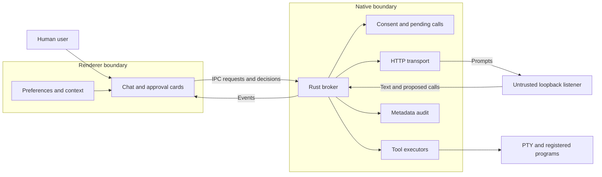

# Threat model — local-assistant boundary (2026-09-28)

Against commit `4f2b5d2`. The verification notes come first; the full threat
model follows below them.

## Verification notes

**Verified against `4f2b5d2`:**

| Claim | Evidence | Verdict |
|---|---|---|
| TM-003 redirects are followed | `ollama::client()` sets `no_proxy` and `connect_timeout` only (`ollama.rs:95-101`); reqwest 0.12.28 is in `Cargo.lock` | Confirmed |
| TM-002 unsolicited calls are acted on | The schema is omitted when tools are not offered (`commands.rs:582-585`), but returned calls are parsed and processed regardless (`:601` onward); `tools::execute` checks only Private Lab consent (`tools.rs:506-509`) | Confirmed |
| TM-001 the renderer supplies consent and approval | `set_private_tools_consent(granted: bool)` (`lib.rs:399`); approvals arrive as IPC booleans | Confirmed |
| TM-005 withdrawal races dispatch | Consent is checked once at `tools::execute` entry; the work runs in `run_blocking` / `spawn_blocking` (`commands.rs:544-549`, `:755`), which an abort does not stop | Confirmed |
| TM-008 call ids derive from the caller's request id | `synthesize_call_id` = `{request_id}-tool-{step}` (`commands.rs:514-515`) | Confirmed |
| TM-006 no response bound | The NDJSON buffer grows by `push_str` with no cap (`commands.rs`, `stream_one_response`); the health timeout wraps `.send()` only, not `.json()` (`ollama.rs`) | Confirmed |
| read_context can be auto-approved | `requires_approval` (`commands.rs:474`) | Confirmed — the earlier assumption that every proposed call needs a human approval does not hold |

**Not accepted as written (see ADR 0014).** Must-fix 1 asks for native
confirmation of consent *and* of every assistant action, and to "cover direct
terminal/launch IPC too". The embedded terminal's keyboard path is itself a
renderer-to-shell route: `terminal_write` (`terminal/commands.rs:207`) has no
consent check by design, because the user's own keystrokes travel through it.
With Private Lab granted, a compromised renderer therefore drives a shell
without the assistant at all, and a native dialog per assistant action would
not change that while breaking the approved inline approval card. What does
close a real hole cheaply is a native confirmation when Private Lab consent is
**granted** (rare), so a compromised renderer cannot escalate a profile that
never enabled it. The residual risk — with Private Lab on, a compromised
renderer has the user's shell, as in any app with an embedded terminal — goes
into an ADR in plain words.

**Routing.** The endpoint hardening takes must-fix 2, 3 and 5 plus the cloud-backed
model refusal. The boundary-hardening work takes must-fix 4, the grant
confirmation from must-fix 1 (subject to ADR 0014), and the "should fix" list.

---

## Executive summary

There are blockers before the endpoint hardening ships under the confirmed security requirements. The existing Rust boundary does not authenticate human consent or approval against a compromised renderer; disabling agent tools only suppresses the advertised schema, rather than rejecting unsolicited calls; HTTP redirects can escape the pinned endpoint; and revocation can race an already-started executor. Accepting 11434 is not inherently a new privilege escalation: either port can host an impostor. Its additional risk is selecting a different, commonly installed—and potentially network-exposed—Ollama. The two-port decision can be retained while addressing these gaps.

## Scope and assumptions

- Inspected the `QutraApp` tree through `git show 4f2b5d2:./<path>`. All line numbers below refer to that commit, although file links open the current checkout.
- Compared the assistant changes between f3de86b and 4f2b5d2. The consent, approval, unsolicited-call and HTTP-client behavior discussed below is present at f3de86b; the later snapshot adds lifecycle handling.
- Covered the requested assistant, consent, settings, client and ADR paths. Followed necessary boundary edges into consent storage, command registration, terminal commands and preference import.
- Excluded GitHub, restore internals, Lab UI, builds and CI.
- Deployment: one-user Windows desktop application; WebView2 renderer; Rust-mediated model traffic; no application server.
- Requirements: prompts and context may be confidential, and a compromised renderer must not be able to manufacture human approval.
- Assume normal user privileges. No administrator compromise, native-process injection or arbitrary modification of the installed application is required by the reported paths.

This was a static review: nothing was built, run or changed, and TypeScript calls were traced from source. Mitigations follow common guidance on untrusted frontend state, native authorization and inert rendering.

Open questions affecting residual risk: the Ollama versions/configurations users will run, and whether the application is ever deliberately launched elevated.

## System model

### Primary components

| Component | Responsibility and evidence |
|---|---|
| React assistant and preferences | Setup choices, context packing, transcript, approval cards. `AssistantSetup.tsx:49`, `LocalAssistantChat.tsx:208` |
| TypeScript IPC client | Sends request flags, messages and approval decisions. `client.ts:346`, `client.ts:385` |
| Rust broker | Starts turns, maintains pending approvals, applies deadlines and dispatches tools. `broker.rs:233`, `commands.rs:559` |
| Rust Ollama transport | Builds requests to 11435; disables proxies; parses model responses. `ollama.rs:16`, `ollama.rs:95` |
| Native consent and executors | Persist Private Lab consent; execute three tool types; resolve registered binaries. `consent.rs:51`, `tools.rs:506`, `tool_supervisor.rs:345` |
| Audit | Bounded, in-memory metadata log; no prompt or command content; no production reader. `audit.rs:17` |

### Data flows and trust boundaries

- **User/preferences → renderer:** setup choices, imported preferences, messages and project metadata. Migration/import clears unproven agent grants, but ordinary preference updates remain renderer-controlled. `assistantConsent.ts:30`, `database.ts:272`.
- **Renderer → Rust, Tauri IPC:** messages, model, context size, opt-in flags and approval booleans. Rust validates some values and matches pending IDs, but these inputs do not prove a human acted. Private Lab grants also arrive as an IPC boolean. `broker.rs:137`, `lib.rs:399`.
- **Rust → loopback listener, HTTP:** prompts, packed metadata, model name and tool definitions. The initial destination is fixed and proxies are disabled; the listener is unauthenticated and redirects remain enabled. Renderer CSP does not constrain Rust. `ollama.rs:95`, `tauri.conf.json:26`.
- **Listener → Rust → renderer:** untrusted NDJSON, text and tool calls. Tool names and argument shapes are checked in Rust; text and approval summaries render as React text. Deadlines exist, but response-byte limits are absent. `tools.rs:334`, `commands.rs:399`, `LocalAssistantChat.tsx:513`.
- **Rust → operating-system executors:** parsed commands/arguments cross into PTYs or detached processes. Private Lab consent is checked at executor entry; launch IDs resolve to enabled, hash-checked installations; terminal reuse requires agent ownership. These are user-privilege actions, not a sandbox. `tools.rs:506`, `tools.rs:610`.

### Diagram

## Assets and security objectives

| Asset | Why it matters | Security objective |
|---|---|---|
| Prompts, history and packed context | May contain confidential work, paths and resource targets | C |
| Consent and approval state | Determines whether data leaves the renderer and actions execute | I |
| User files and reachable services | Approved shell commands can affect anything available to the app's account | C/I/A |
| Selected endpoint/model | Determines who receives data and generates proposals | C/I |
| Application and local compute | Malformed or excessive traffic can exhaust memory or inference capacity | A |
| Approval/audit evidence | Must distinguish actual human decisions from submitted IPC values | I |

## Attacker model

**Capabilities**

- An attacker-controlled local process can bind either permitted port when available, receive prompts and return arbitrary protocol responses.
- A compromised renderer can invoke commands available to that renderer, read streamed IDs, change preferences and submit approval booleans.
- Malicious context or model output can influence proposals and persuade the user.
- A network attacker may interact with an Ollama deliberately bound beyond loopback, subject to firewall reachability.

**Non-capabilities**

- A remote attacker cannot simply connect to an exclusively loopback listener.
- Port ownership alone does not let an attacker replace an established TCP connection.
- Model text does not become renderer JavaScript in the inspected plain-text rendering paths.
- The model cannot directly select the Rust HTTP destination through the current request structure.
- No administrator elevation or native-code vulnerability was demonstrated.

## Entry points and attack surfaces

| Surface | How reached | Trust boundary | Notes | Evidence |
|---|---|---|---|---|
| Setup and preference import | User actions/imported profile | Stored data → renderer | Import strips agent grant and confirmation epoch | `assistantConsent.ts:57` |
| Health/models/start IPC | Renderer command invocation | Renderer → Rust | Enablement is supplied by caller; start checks only enablement, nonempty model and busy state | `broker.rs:233` |
| Consent setter | Renderer IPC | Renderer → native authorization | Accepts `granted` directly | `lib.rs:399` |
| Approval/cancel/abandon IPC | Renderer IPC | Renderer → broker lifecycle | Matching IDs establish correlation, not human provenance | `commands.rs:847` |
| Ollama responses | Tags/show/chat HTTP | Listener → Rust | Redirects, JSON and streamed data are attacker-controlled | `ollama.rs:109` |
| Tool dispatch | Parsed model call | Model → native action | Closed three-tool set; Private Lab checked at entry | `tools.rs:506` |
| Existing terminal/launch IPC | Renderer invokes native command directly | Renderer → OS | Must be considered when protecting against renderer compromise | `terminal/commands.rs:207`, `lib.rs:564` |

## Top abuse paths

1. **TM-001 — Manufacture authorization:** compromise renderer → submit Private Lab grant and enabled flags → observe a pending call → submit `approved: true` → execute without a human decision. Direct terminal/launch IPC also prevents an assistant-only approval fix from protecting the whole executor boundary.
2. **TM-002 — Escape answer-only mode:** Private Lab remains granted while agent proposals are off → malicious listener returns an unsolicited allowlisted call → Rust parses and processes it despite omitting the tool schema → execution occurs after approval, or immediately for an auto-approved read. The missing agent consent is not repaired by approving one call.
3. **TM-003 — Escape the endpoint set:** control the loopback responder → return an HTTP redirect → Rust follows it to another origin. A 307/308 can preserve the chat POST body. This existed with 11435 alone; `no_proxy()` does not prevent it.
4. **TM-004 — Substitute listener/model:** occupy a permitted port or let discovery select another Ollama → pass compatibility probes → receive confidential prompts or produce unexpected proposals. A restart between probe and request can change the listener; model tags can change independently.
5. **TM-005 — Execute after withdrawal:** obtain approval → execution enters the blocking worker and passes consent → user revokes/stops while identity resolution or other preparation is running → worker reaches spawn/write anyway. Revoking and regranting Private Lab also leaves an old pending call eligible because no consent generation invalidates it.
6. **TM-006 — Exhaust local resources:** malicious listener returns enormous JSON, an endless unterminated NDJSON line or excessive tool calls → Rust accumulates data → application memory/availability suffers. Health response-body reads can also outlive the nominal health timeout.
7. **TM-007 — Persuade a harmful approval:** inject instructions through context or model output → propose an apparently useful shell line → user approves → command exercises normal account privileges. A three-name tool allowlist does not bound what `terminal_run` can do.
8. **TM-008 — Reuse approval identity:** IPC caller reuses a request ID → a later turn synthesizes the same step-based call ID → an old decision can match a new pending call. Ordinary UI-generated UUIDs mitigate this; Rust does not enforce their uniqueness.

## Consent and approval gate verdict

| Path | Result |
|---|---|
| Normal setup | Distinct answer-only and agent choices are present. |
| Normal import/migration | Agent grant is cleared; I found no direct bypass in the inspected import path. Imported read-auto-approval can remain enabled. |
| Model output | Agent-off is not enforced when consuming returned tool calls. |
| Compromised renderer | Can submit grants and approvals. Native storage does not authenticate their origin. |
| Stale approval card | Different request/call IDs are rejected; consumed decisions cannot be reused. Caller-controlled request-ID reuse remains a gap. |
| Revocation before executor entry | Private Lab denial blocks execution. |
| Revocation during execution preparation | Not synchronized with the eventual side effect. Assistant/agent enablement is not checked there. |

The statement "every proposed call needs a human approval" is also broader than the implementation: `read_context` can be auto-approved when `auto_approve_reads` is true. Side-effecting tools always enter the approval branch. `commands.rs:474`.

## Endpoint findings

**11434 versus 11435.** Neither port authenticates its listener. A standard-user process can impersonate either while it is free. Preferentially probing 11434 additionally allows a listener there to win selection even while the intended 11435 lab is running. Because 11434 is Ollama's default, accidental selection of another installation or model catalog is more plausible. Binding with `OLLAMA_HOST=0.0.0.0` can expose that service to other machines; the app connecting through 127.0.0.1 does not undo that exposure. It does not, by itself, prove remote users can retrieve this app's conversations. (Ollama FAQ.)

**Probe then use.** Between those operations, the listener can restart, model availability or tag contents can change, consent can be revoked, or a global endpoint selection can be replaced. Keep the selected endpoint and model bound to the turn. Re-check live authorization, the exact destination/method/path policy, and cancellation generation before each request and tool dispatch. Revalidate model availability on an endpoint change; never silently substitute another model or replay a partly completed agent turn on the fallback endpoint.

**What stays in Rust.** A closed endpoint enum with exactly the two literal HTTP origins; discovery order; fixed API paths; proxy and redirect policy; turn-bound selection; authorization and response limits. IPC/preferences/model output must not supply a URL. The UI should display the endpoint Rust actually selected, rather than deriving it from a TypeScript constant.

**Authenticating Ollama.** Version/tags/show responses are useful compatibility checks, but an impostor can copy them. There is no cheap HTTP handshake here that proves listener identity. Process/signature inspection would add Windows-specific complexity and its own races. A visible statement of the selected endpoint and model, plus an honest "local service identity is not verified" explanation, is proportionate; strong authentication would require an independently trusted mechanism.

Also, a real Ollama can route requests from its local API to cloud models. Thus "sent to loopback" cannot establish "inference stayed local." This does not reopen the cloud decision: until that flow is built, avoid silently treating a cloud-backed selection as local execution. (Ollama authentication documentation.)

## Threat model table

| Threat ID | Threat source | Prerequisites | Threat action | Impact | Impacted assets | Existing controls (evidence) | Gaps | Recommended mitigations | Detection ideas | Likelihood | Impact severity | Priority |
|---|---|---|---|---|---|---|---|---|---|---|---|---|
| TM-001 | Compromised renderer | Script execution in authorized WebView | Forge grants/approval IPC | Unauthorized native execution | Consent, files, data | Pending-ID matching: `broker.rs:400` | Same renderer supplies all evidence of human action | Rust-owned grants and independent native confirmation; cover direct executor routes | Record trusted decision source and refused caller | Medium: compromise prerequisite; then straightforward | High: account-level actions | high |
| TM-002 | Model/listener | Chat enabled; Private Lab granted; agent disabled | Return unsolicited call | Action without agent opt-in; metadata disclosure | Consent, context, files | Schema conjunction: `commands.rs:504`; Private Lab check: `tools.rs:506` | Schema omission is not dispatch denial | Enforce agent authorization when consuming proposals and at dispatch | Record unexpected calls while disabled | Medium: arbitrary listener can emit calls | High for side effects; narrower for reads | high |
| TM-003 | Loopback responder | Controls permitted listener | Redirect request outside set | Confidential POST disclosure; arbitrary-origin requests | Prompts/context | Fixed URL and no proxy: `ollama.rs:95` | Default redirect policy | Disable all redirects on shared client | Record rejected redirect status without content | Medium: listener control required | High: confidential data leaves boundary | high |
| TM-004 | Local impostor or unintended service | Port available or different Ollama selected | Receive prompts; substitute model behavior | Data exposure or misleading proposals | Prompts, model integrity | Fixed initial origin: `ollama.rs:16` | No service authentication; endpoint discovery can change recipient | Bind endpoint/model per turn; disclose selection and changes; no silent model fallback | Endpoint/model change events | Medium: wrong default service is plausible | High: confidential prompts exposed | medium |
| TM-005 | Timing/race | Approved action overlaps stop/revoke | Continue blocking dispatch or revive old pending call | Side effect after withdrawal | Authorization, files | Entry consent check and task abort: `tools.rs:506`, `broker.rs:293` | No dispatch synchronization or consent generation | Invalidate old work; synchronize final authorization with dispatch | Record cancellation generation and committed dispatch | Medium: genuine concurrent window | High: unwanted native action | high |
| TM-006 | Listener or renderer | Can supply protocol/IPC payloads | Oversized responses, hanging bodies, parallel starts | Memory/compute exhaustion | Availability | Timeouts and intended single-flight: `commands.rs:399`, `broker.rs:233` | Unbounded sizes; header-only health timeout; separate check/reservation | Byte/count limits; full-body deadlines; atomic start reservation | Size-limit and busy refusals | Medium: easy once input source controlled | Medium: local app disruption | medium |
| TM-007 | Injected context/model | User approves deceptive action | Induce harmful shell execution | User-account data damage/exposure | Files, data | Plain-text exact summary; strict tool parsing: `tools.rs:203`, `LocalAssistantChat.tsx:552` | Shell capability remains broad; approval fatigue | Preserve full exact action display; expose control characters; describe shell authority honestly | Metadata-only proposal/outcome review | Medium: requires misleading human approval | High: shell has account privileges | medium |
| TM-008 | IPC caller/stale event | Request ID reused across turns | Reuse matching approval identity | Wrong call approved | Approval integrity | Two-ID match; model IDs ignored: `broker.rs:400`, `commands.rs:514` | IDs derive from caller-controlled request ID | Rust-generated unique turn/call nonce, consumed once | Reject duplicate/replayed identities | Low in normal UI; higher after renderer compromise | High for wrong side effect | medium |

For TM-003, I checked the locally cached reqwest 0.12.28 source: the client uses the default ten-hop policy and supports cloning bodies for 307/308 redirects. This agrees with the reqwest redirect documentation.

For TM-005, aborting the parent async task does not stop an already-running blocking closure. Tokio documents this explicitly. This is a pre-dispatch race finding, not a claim that Stop can undo an already-executed command.

## Criticality calibration

| Level | Meaning here | Tailored examples |
|---|---|---|
| critical | Reliable severe compromise without an additional privileged foothold or meaningful human action | Model response directly executes arbitrary native code; unauthenticated remote input obtains elevated execution. Neither demonstrated. |
| high | Confidential-data escape or unauthorized account-level action across a required boundary | Forged renderer approval; redirected prompt POST; execution after authorization withdrawal. |
| medium | Material risk requiring additional timing, local control or human error | Wrong local listener; response-memory exhaustion; harmful command knowingly submitted through an approval flow. |
| low | Limited operational or informational harm | Stale endpoint label alone; delayed recovery with no new execution or disclosure. |

The confirmed confidentiality and renderer-compromise requirements drive the high findings. No evidence supports calling this a remote, unauthenticated critical vulnerability.

## Focus paths for security review

| Path | Why it matters | Related Threat IDs |
|---|---|---|
| `src-tauri/src/assistant/commands.rs:582` | Separate advertising tools from authorizing returned calls; bind approval and cancellation to dispatch | TM-001, TM-002, TM-005 |
| `src-tauri/src/assistant/broker.rs:233` | Native authorization state, unique IDs and atomic turn reservation | TM-001, TM-006, TM-008 |
| `src-tauri/src/assistant/ollama.rs:95` | Redirect policy, closed endpoint selection, body limits and deadlines | TM-003, TM-004, TM-006 |
| `src-tauri/src/assistant/tools.rs:506` | Last authorization boundary before native actions | TM-002, TM-005, TM-007 |
| `src-tauri/src/consent.rs:71` | Grant provenance, revocation generation and failure behavior | TM-001, TM-005 |
| `src-tauri/src/lib.rs:399` | Renderer-callable grant setter and alternate execution routes | TM-001 |
| `src/app/workbench/Workbench.tsx:48` | Async consent synchronization and swallowed native failures | TM-001, TM-005 |
| `src/domain/assistantConsent.ts:57` | Keep import sanitization distinct from trusted grant authority | TM-001, TM-002 |
| `src/features/jarvis/LocalAssistantChat.tsx:355` | Exact action display, approval outcome and lifecycle handling | TM-001, TM-007, TM-008 |
| `src/features/settings/LocalAssistantSettings.tsx:45` | Display actual Rust-selected endpoint/model | TM-004 |

## Notes on use

The findings are source-grounded, not reproduced exploits. Existing tests were inspected, not executed. In particular, the current conjunction tests prove schema advertising, not rejection of unsolicited model calls; the executor's own comments acknowledge that its consent gate lacks direct test coverage.

The endpoint hardening should add these regression tests:

- Both literal endpoints work; probe 11434 first and use 11435 only under explicitly defined fallback conditions.
- Preference, IPC and model-supplied URL fields cannot change any destination; all tags/show/chat requests stay within the closed set.
- Redirects—including 307/308 chat redirects—produce zero requests to the redirect target; configured proxies receive zero traffic.
- Discovery, model probes and chat remain bound to one endpoint selection; restart/model disappearance fails visibly; no automatic model substitution or mid-turn replay.
- Exercise every consent combination with unsolicited tool calls, including auto-approved reads; assert no executor call when agent consent is absent.
- Race revoke/stop against delayed dispatch; revoked generations never execute or become valid again after regrant.
- A compromised main renderer cannot grant consent or approve a pending action through direct IPC, including alternate executor routes.

Coverage check: all discovered assistant entry points covered; every boundary represented; runtime separated from build/CI; the stated requirements incorporated; unresolved service identity and deployment assumptions explicit.

## Must fix before the endpoint hardening ships

1. **Authenticate consent and human approval** — `commands.rs:847`, `lib.rs:399`, `broker.rs:137`. The compromised renderer can manufacture all required booleans. Minimum adequate mitigation: native-owned grants established through an independent native confirmation surface, and a native per-action confirmation bound to the immutable parsed action. Cover direct terminal/launch IPC too. Another renderer-provided token or boolean is insufficient.
2. **Reject tools when agent consent is absent** — `commands.rs:601`, `tools.rs:506`. Unsolicited calls bypass answer-only mode. Reject them before approval and re-check authoritative agent consent at dispatch.
3. **Disable redirects** — `ollama.rs:95`. The initial fixed URL does not constrain subsequent HTTP destinations. Add `redirect(reqwest::redirect::Policy::none())` to the shared client and test that no redirected request is sent.
4. **Make withdrawal effective at dispatch** — `commands.rs:755`, `tools.rs:557`. Blocking work can spawn/write after stop or revoke. Introduce a cancellation/consent generation and synchronize its final check with dispatch; invalidate pending approvals on withdrawal. This need not undo actions already committed.
5. **Complete the enforcement and disclosure contract of the two-origin endpoint decision.** Keep the two origins and selection logic in Rust, bind endpoint/model to each turn, disable silent mid-turn fallback, and display Rust's actual selection. Update ADR 0010's explicit 11434 prohibition and the old fixed-endpoint UI/tests. This implements the decision without widening the endpoint set.

## Should fix

- **Bound untrusted traffic** — `commands.rs:427`, `ollama.rs:120`. Add response/line/tool-call limits, native request limits and full-body health deadlines.
- **Generate identities and reserve turns atomically** — `broker.rs:233`, `commands.rs:514`. Separate busy checking from reservation permits overlapping starts; reused caller IDs undermine stale-card guarantees. Use a Rust-generated generation/nonce and one atomic reservation.
- **Surface consent synchronization failures** — `Workbench.tsx:53`. A failed revoke can leave native consent granted while the UI behaves as revoked. Show failure and retain a retryable, truthful native state.
- **Make security copy match actual capabilities** — `assistantContext.ts:154`, ADR 0012 Decision 1. Describe the read-auto-approval exception and arbitrary-shell authority accurately. Render control characters visibly in approval text, and identify endpoint/model changes without claiming that a compatible loopback service is authenticated.
