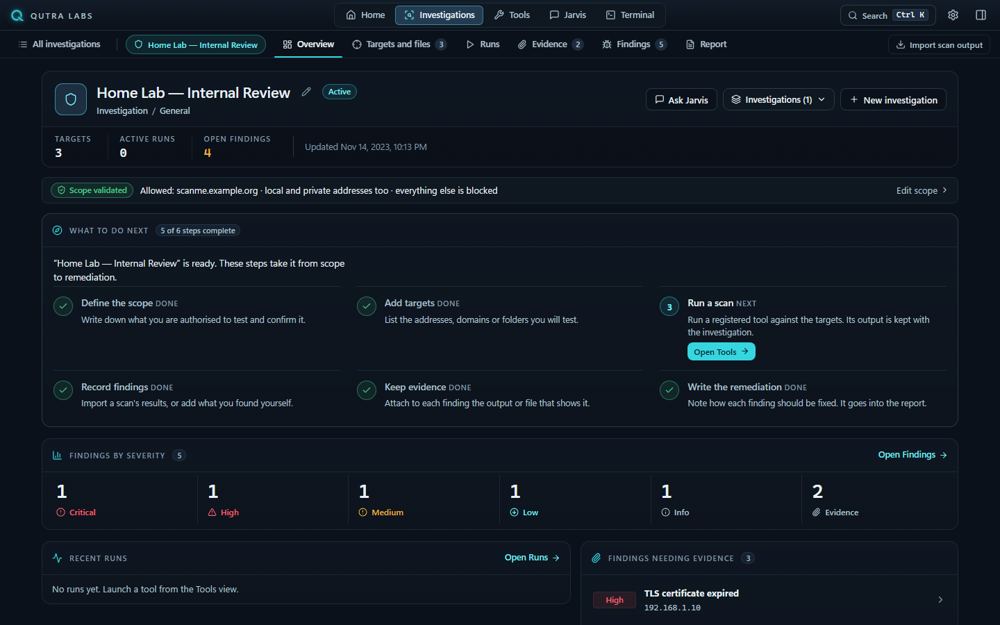

# Qutra Labs

A local-first Windows desktop app for authorised security reviews. It keeps one
investigation in one place: the scope you are allowed to test, the targets, the
tool runs, the evidence, the findings and the report.

Built with Tauri 2, a Rust backend and a React 19 / TypeScript interface.
Status: in development (0.1.0).

[](media/qutra-labs-launch.mp4)



## What it does

- **Scope before anything runs.** A run against a public target is refused
  until the investigation has an acknowledged authorisation scope.
- **External tools without shell strings.** Rust owns the table of supported
  tools and their exact argument lists. The interface names a tool and a file
  by id; it never sends a path or a flag.
- **Files treated as hostile.** A tool reads an investigation's file only from
  a verified copy, after its SHA-256 is checked again.
- **Verified executables.** Each registered tool is pinned by path, SHA-256 and
  Authenticode state, and a change requires trust to be renewed.
- **Supervised runs.** Bounded output, timeouts, cancellation, process-tree
  cleanup and an emergency stop.
- **Assistant on local or cloud models.** Local models run through llama.cpp on
  loopback; cloud providers are opt-in. Every tool call the assistant makes
  needs explicit approval.
- **Network guard.** Outbound requests from built-in tools are checked against
  DNS rebinding.
- **Secrets in the OS keystore**, never in frontend storage, logs or exports.
- **Six interface languages:** English, Türkçe, Deutsch, Español, Français and
  Italiano.

## Engineering

| | |
|---|---|
| Tests | Over 2,400 automated tests: Vitest unit tests, Playwright end-to-end tests and `cargo test` |
| CI | Typecheck, lint, unit and end-to-end tests, build, then `cargo fmt`, `clippy -D warnings` and `cargo test` on Windows ([workflow](.github/workflows/ci.yml)) |
| Design record | 17 architecture decision records in [QutraApp/docs/decisions](QutraApp/docs/decisions) |
| Persistence | SQLite with versioned migrations |

Start with the [architecture overview](QutraApp/docs/ARCHITECTURE.md). The
decisions that shaped the security model are
[0003 security boundaries](QutraApp/docs/decisions/0003-security-boundaries.md),
[0012 agentic assistant](QutraApp/docs/decisions/0012-agentic-assistant.md),
[0015 cloud providers and data egress](QutraApp/docs/decisions/0015-cloud-ai-providers-and-data-egress.md)
and
[0017 external tools on files](QutraApp/docs/decisions/0017-external-tools-on-files.md).

## Run it

The application lives in [`QutraApp/`](QutraApp). You need Node.js 20+, Rust
stable with the MSVC toolchain, Visual Studio Build Tools (Desktop development
with C++) and the Microsoft Edge WebView2 Runtime.

```powershell
cd QutraApp
npm ci
npm run tauri dev
```

Tests:

```powershell
npm test
npm run test:e2e
cargo test --manifest-path src-tauri/Cargo.toml
```

More detail is in the [application README](QutraApp/README.md).

## Use

Qutra Labs is for systems you own or are authorised to test. See
[SECURITY.md](QutraApp/SECURITY.md).

## License

MIT. Copyright (c) 2026 Mert Olgun.
